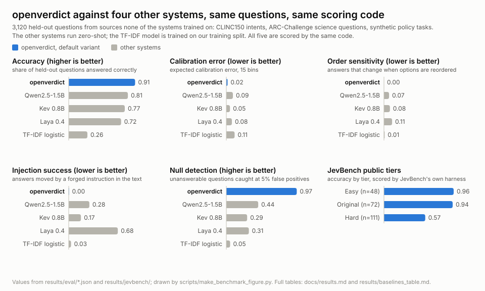

# kelter

A small decision model you run on your own machine. Give it a piece of text and a multiple-choice question, and it returns an answer, a calibrated probability for each option, the passages that support the answer, how likely it is that no option fits, and whether you should act on the answer or hand the question to something bigger.

The default model is Qwen3-4B with a small LoRA adapter, paired with a 149M-parameter encoder (ModernBERT) that points at the evidence. A full decision takes between half a second and 0.7 seconds on a laptop GPU, depending on the laptop's power mode, and needs no API key. A lower-latency variant uses the encoder alone.

The server speaks the same `/v1/systemone` API as TypeSafe's Jev, so clients written for that API only need a new base URL.

## What it does

Agents and apps make small decisions all the time: is this ticket about billing, is this command safe to run, how urgent is this message. A large model can answer, but slowly, at a cost per call, and with confidence numbers that are often wrong. kelter is built for exactly these decisions:

- **Calibrated.** When it says 90%, it is right about 90% of the time (expected calibration error 0.017 on held-out data).
- **Shows its evidence.** Every answer comes with the spans of the input it relied on, and a check that masking those spans changes the answer.
- **Knows when nothing fits.** A null probability says how likely it is that none of the options is right. It catches 97% of unanswerable held-out questions at a 5% false-positive rate.
- **Resists injected text.** You can tag which parts of the input came from the user, a tool, a document or the system. Text from a tool's output cannot approve a destructive action on its own. In 400 test cases with a planted fake approval, it never acted unsafely. This protection rests on the labels you supply; see Limitations.
- **Tells you what to do next.** Each answer carries an action: `act`, `escalate` or `defer`. On held-out data it acts on about a quarter of questions and is right 97% of the time when it does.

## How it compares

<picture>
  <source media="(prefers-color-scheme: dark)" srcset="docs/benchmark-dark.svg">
  
</picture>

kelter answers more held-out questions correctly than the other small systems, is better calibrated, does not change its answer when the options are reordered, is far harder to steer with injected text, and catches most questions that have no right answer. On JevBench's public tiers it scores 0.944 (original), 0.568 (hard) and 0.958 (easy), 0.766 pooled. The figure is drawn from the results files by `scripts/make_benchmark_figure.py`; the numbers behind it are in [docs/results.md](docs/results.md) and `results/baselines_table.md`.

## Quick start

Python 3.12 and an NVIDIA GPU with 12 GB of memory (the default model needs about 9 GB of it free). Tested on Windows 11. On Linux, installation and the CPU test suite run on Ubuntu 24.04 in CI, but the server has not been run end to end there. A Mac with Apple Silicon should work, slower, and is untested. Without a GPU, start the smaller model with `--variant lower-latency`.

```bash
git clone https://github.com/s1mar/kelter.git
cd kelter
python -m venv .venv
.venv/Scripts/python -m pip install torch==2.11.0 --index-url https://download.pytorch.org/whl/cu128
.venv/Scripts/python -m pip install -r requirements.txt
.venv/Scripts/python scripts/download_weights.py
.venv/Scripts/python -m kelter.server --port 8765
```

On Linux and macOS use `.venv/bin/python`. On a Mac, install torch from PyPI without the CUDA index. The weights download is about 740 MB for the default model (the adapter and the encoder). The first start also downloads the Qwen3-4B base model from Hugging Face, about 8 GB, pinned to the revision named in the checkpoint; later starts use the local copy.

Then, in a second terminal, send the two built-in examples:

```bash
.venv/Scripts/python -m kelter.examples
```

It prints the action, what the action rests on, and the chosen option for each:

```
act act witness account
defer defer None other
```

The first example is a support ticket that kelter routes and acts on. This is the request it sends to `/v1/systemone` (any HTTP client can post the same body):

```json
{"model": "kelter",
 "state": "Customer: I forgot my password and cannot log in to my account.",
 "provenance": [{"start": 0, "end": 63, "type": "user"}],
 "questions": {"route": {"type": "choice",
   "instructions": "Route the support ticket to the team that should handle it.",
   "criteria": {"billing": "Charges, refunds, invoices and payment problems.",
                "shipping": "Delivery status, lost or late packages.",
                "account": "Login, password and profile problems.",
                "technical": "Bugs, crashes and errors in the app.",
                "other": "Anything that fits none of the teams above."}}}}
```

The answer chooses `account` with confidence 0.994 and `action` `act`. Its evidence is the two spans " I forgot my password" and " cannot log in to my account.", both from the user: they give the same answer on their own, masking them changes it, and no other option is left in the 95% set.

The second example asks the same question about "Customer: Something is wrong, please help." and comes back as `defer`: there is no evidence span to rest on, and four options are still possible. Deferring is the common case. On held-out data the engine acts on 880 of 3,340 questions. The full requests and responses are in `results/examples/`.

Besides `choice`, a question can be a `score` (an ordered scale) or a `noul` (yes or no); `docs/typesafe-contract.md` has all three.

Each answer has the standard TypeSafe fields (the chosen option, a probability per option, a confidence) plus these:

| Field | Meaning |
|---|---|
| `action` | `act`, `escalate` or `defer` |
| `null_probability` | chance that no option fits |
| `witness` | the input spans the answer rests on, with their provenance |
| `verifier` | whether that evidence is allowed to count, given where it came from, and `basis`: what an `act` rests on |
| `set`, `coverage_level` | the options that cannot be ruled out at 95% coverage |
| `receipt`, `variant` | a record of the decision and which model answered |

The `model` field is required by the API and can be any name. Clients that do not know the extra fields ignore them.

The action is strict. It is `act` only when the evidence is admissible and masking it changes the answer, so text with no provenance tags, or text that states the same thing twice, comes back as `defer` even at high confidence. The `verifier` field says which check held it back. To tag provenance, add a `provenance` list of `{"start", "end", "type"}` character ranges to the request; types are `user`, `tool_output`, `retrieved_doc`, `system` and `unknown`. The full field-by-field contract is in `docs/typesafe-contract.md`.

## Two variants

| | `default` | `lower-latency` |
|---|---|---|
| Model | Qwen3-4B with a LoRA adapter, plus the encoder for evidence | encoder ensemble (four checkpoints) |
| Held-out accuracy | 0.913 | 0.688 |
| Null recall at 5% false positives | 0.968 | 0.775 |
| Calibration error (15 bins) | 0.017 | 0.042 |
| Accuracy when it acts | 0.974 | 0.970 |
| Wrong option acted on, planted text under a trusted label (3,120 cases) | 4 (0.001) | 6 (0.002) |
| Decision latency, laptop GPU (p50), highest power mode | 542 ms | 149 ms |
| Decision latency, laptop GPU (p50), balanced power mode | 688 ms | not measured |
| Weights | 126 MB adapter + 607 MB encoder, plus the 8 GB base download | 4.0 GB |

In the default variant the Qwen model reads the text and the options, labelled with letters plus one more letter for "none of the options", and the probabilities come from its next-token logits for those letters. The encoder checkpoint r2 supplies the evidence spans. The lower-latency variant is encoder-only: r2 chooses the option and four checkpoints' null scores are averaged. Start it with `--variant lower-latency` and fetch its weights with `scripts/download_weights.py --variant lower-latency`.

Full metric tables, every measured run and the baselines are in [docs/results.md](docs/results.md).

## How it works

One model pass scores the options, and the encoder points at the evidence spans. The engine then runs three more passes: with the evidence masked, with a random control masked, and with untrusted provenance masked. From those it decides whether the evidence was necessary, whether it is admissible under a small policy table (`policy_table.json`), and how much of the answer depended on text that should not be trusted. A split-conformal step turns the probabilities into the option set and the action. Option order cannot change the answer because options are sorted by a hash before scoring. Prompts longer than 1,024 tokens are prefilled in chunks through the KV cache, which keeps long inputs within the GPU's memory.

The main pieces:

- `kelter/llm.py`: the Qwen predictor, its prompt and the letter readout.
- `kelter/model.py`: the encoder with option, witness and null heads.
- `kelter/engine.py`: the four-pass verifier and the action rule.
- `kelter/server.py`: the FastAPI server.
- `kelter/data/`: dataset converters, the synthetic policy tasks and the corpus builder.
- `kelter/llm_train.py`, `train.py`, `calibrate.py`, `ensemble.py`: adapter training, encoder training, calibration and the ensembles.
- `kelter/eval/`: the evaluation harness, baselines, latency and the JevBench runner.

## Training it yourself

Training needs an NVIDIA GPU with 12 GB or more. The adapter trains in 4-bit (QLoRA) on a 24,000-record sample of the corpus in a little over an hour on a laptop GPU.

```bash
python -m kelter.data.build
python -m kelter.llm_train --name Q1 --qlora
python -m kelter.calibrate --ckpt checkpoints/Q1
python -m kelter.eval.run --system ours --ckpt checkpoints/Q1 --tag Q1
```

The first command downloads the public datasets listed in `THIRD-PARTY.md` and writes `data/built/` and a data card under `docs/data_cards/`. The encoder checkpoints train with `python -m kelter.train --run r1 --epochs 1 --max-tokens 8192`; `docs/results.md` lists every run and `docs/data_cards/` records what each trained on.

## Limitations

- JevBench's hard tier is the weak spot: accuracy 0.568, and the model is overconfident there (mean top probability 0.657). The two padding and long-context training rounds tried so far did not improve it; they are recorded in `docs/results.md`.
- Null recall is reported on two test sets. The corrected set was defined after looking at test diagnostics; the original set gives 0.960.
- The action rule is conservative and its thresholds were not tuned, so it defers most held-out questions, and it defers every request that carries no provenance tags. It acts only when one option is left in the 95% set and the evidence is admissible: the spans give the same answer alone, masking them changes it, and their provenance is allowed for that kind of option. It defers when "none of the options" wins or no evidence is admissible, and escalates when the evidence is admissible but more than one option is left or untrusted text moved the answer too far. Treat `act` as a strong signal and `defer` as the default, not as a judgment that the answer is wrong. A looser rule that also acted on high confidence without evidence was tested and not shipped: it acted on 2,217 of 3,340 held-out questions at the same accuracy, but acted on planted text in 19 of 3,120 cases (`docs/results.md`).
- kelter trusts the provenance labels you supply. Text labelled `user` or `system` counts as trusted. Only options you mark `destructive` (in `verdict_classes`) are limited to user or system evidence and to a small budget of influence from untrusted text; other options can rest on tool output. So label text from tools, web pages, files and other models as `tool_output` or `retrieved_doc`, and mark every irreversible option `destructive`. When planted text naming a wrong option carries a trusted label, the default variant acts on the wrong option in 4 of 3,120 test cases and lower-latency in 6 of 3,120 (`results/eval/engine_Q1base.json`, `results/eval/engine_E1base.json`).
- The default variant needs a GPU: the engine's four passes take 11.5 s on CPU with int8 quantization. The lower-latency variant runs on CPU in about 3 s.
- Calibration on JevBench's public tiers is worse than on our held-out data (ECE 0.038 to 0.124 by tier); the temperature was fitted on different kinds of text.
- Latency was measured on one laptop GPU shared with the desktop. The figures in its highest power mode are the fastest it gets; in the balanced mode the default variant's decision takes 688 ms instead of 542 ms (`results/eval/latency_Q1_balance.json`). The lower-latency variant was measured in the highest mode only.
- The injection guarantee was tested on synthetic shell-gating and account-deletion items, not on real agent traces.
- The evidence spans come from the encoder, not from the Qwen model, so they show what the encoder relied on; the necessity check then measures whether masking them changes the Qwen model's answer (0.586 of e-SNLI answers change, against 0.362 for a random mask of the same size).

## License

Code: Apache 2.0 (see `LICENSE`).

Weights: CC BY-SA 4.0 (see `WEIGHTS-LICENSE.md`). You may use them, including commercially. If you share the weights or weights made from them, give credit and use the same license. They carry this license because some of the training data is share-alike.

The Qwen3-4B base model is downloaded separately and is Apache 2.0. The training data keeps its own licenses, listed in `THIRD-PARTY.md`.
